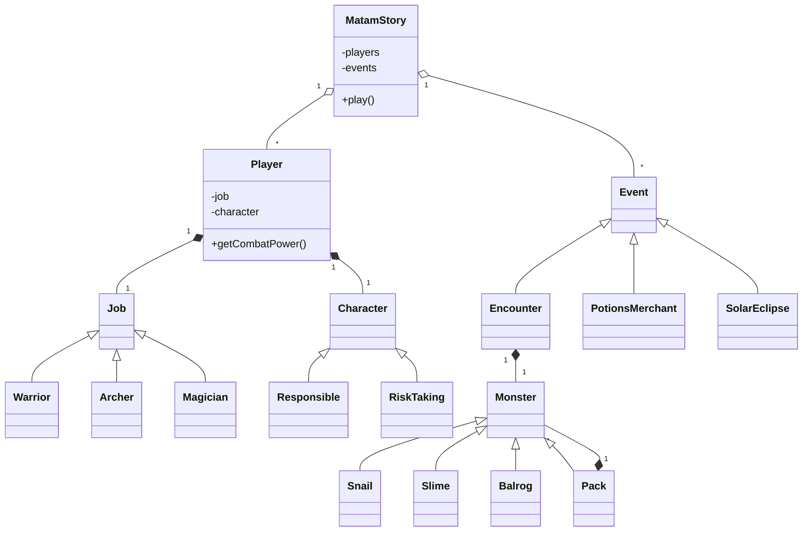

# Architecture

MatamStory is a small **console game**, structured around composition and
polymorphic behavior rather than a graphical engine.

## Responsibilities

- **Game loop** (`MatamStory`): parse input, advance turns, cycle through
  events, finish the game, sort and print the leaderboard.
- **Player**: mutable health, force, coins and level; owns a job and a
  character strategy.
- **Jobs** (`Warrior`, `Archer`, `Magician`): adjust initial player
  attributes, combat strength, and reactions to special events.
- **Characters** (`Responsible`, `RiskTaking`): change potion-buying
  decisions independently of a player's job.
- **Events**: provide a common interface for monster encounters and
  special events.
- **Monster packs**: recursively contain other monsters, including nested
  packs; their aggregate statistics change as members evolve.

Polymorphic objects are held by `std::unique_ptr`, which expresses ownership
and avoids manual `delete` calls.

## Scope

This is a coursework-scale model of a turn-based game. It deliberately has
no rendering loop, graphical UI, network play or save system.
